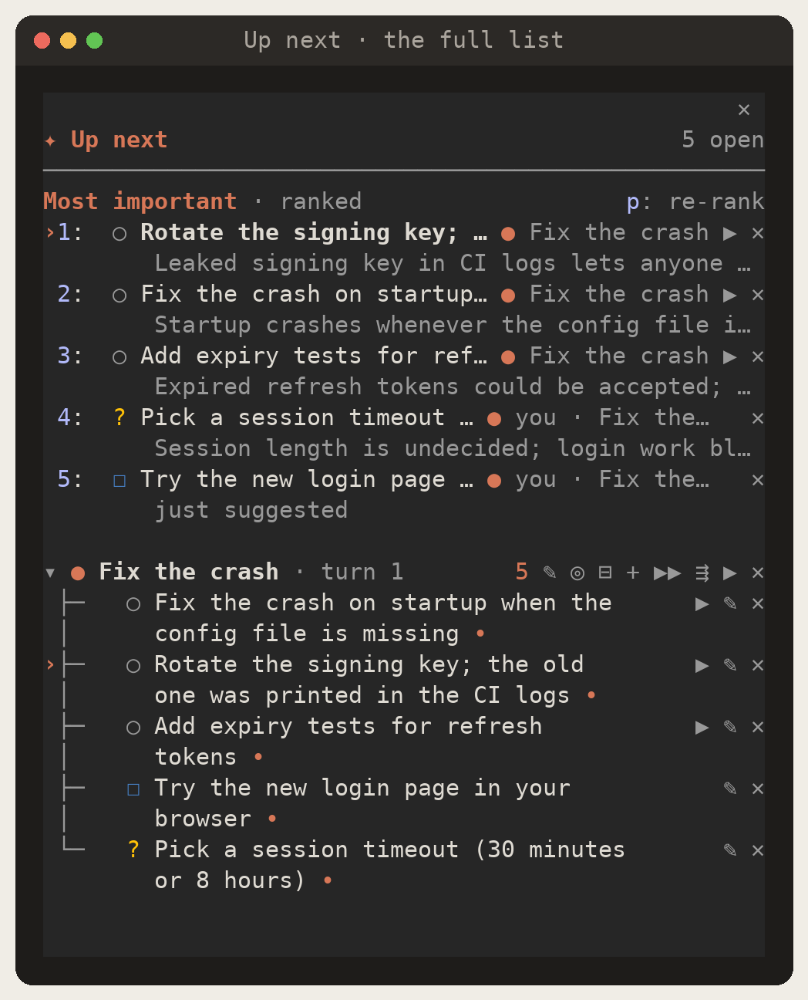
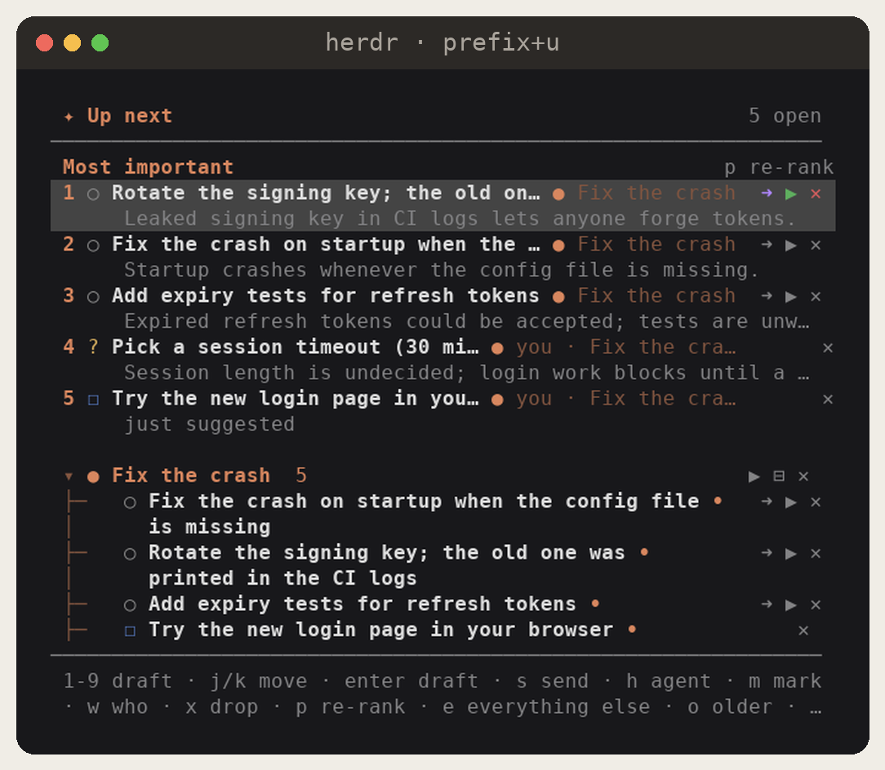

<p align="center">
  
</p>

<h1 align="center">upnext</h1>

<p align="center">A Claude Code mod that keeps track of what to do next, so suggestions stop getting lost.</p>

## The problem

Most Claude replies end with suggestions: a "Next steps" list, "Want me to also…", a hint in some command's output. In a long session they go wrong in predictable ways:

- **They scroll away.** Each new reply buries the last one's suggestions, and the good ideas are forgotten.
- **You lose track of what's open.** With several lines of work going at once, nothing tells you what is still left, or what matters most.
- **Acting on one means retyping it.** You copy or paraphrase a suggestion back into the prompt box.
- **Not every suggestion is a prompt.** "Try the new pane" or "pick a license" are for you to do, mixed in with work for Claude.
- **Lists go stale.** Finished items linger and old ideas crowd out what matters now.

## What upnext does

- **Collects** suggestions from replies and tool output as they appear, grouped by line of work.
- **Ranks** them and shows the top three, with the reason for each, right above the prompt box. One key acts on a step.
- **Clears** steps as they get done: by a prompt you type, a commit, a passing test run, or a click. Untouched ones fade and then fold away.
- **Separates** steps for you (try, check, decide) from prompts for Claude, so yours are never sent by accident.

Each session keeps its own list.

## How it looks

Claude finishes a reply with five suggestions. Up next ranks them and puts the three that matter most right above the prompt box, each with the reason it matters. The leaked signing key goes to the top:


From an empty prompt box, `1` `2` `3` act on a step: a prompt is drafted for you to send, a check (☐) is ticked off, a decision (?) starts your answer. `0` hides the lines until the next turn.

The whole list opens with `/upnext`, as a pane beside the transcript: the ranked steps with their reasons, then everything grouped by line of work. Steps for you are marked ? (decide) and ☐ (try), and are never sent to Claude:

<p align="center"></p>

## Install

At the prompt of a Claude Code terminal session:

```
/plugin install upnext --marketplace rseac/upnext
```

Answer `y` to add the marketplace, then pick a scope (user scope is first; press Enter).

From a shell:

```
claude plugin install upnext --marketplace rseac/upnext
```

In the desktop app, where `/plugin` does not run: click + next to the prompt box, then Plugins, Add marketplace with `rseac/upnext`, then Add plugin.

## Set up with an agent

Point Claude Code (or another coding agent) at this section and it will set upnext up for you. Paste this into a Claude Code session:

```
Set up upnext by following the "Set up with an agent" section of the README in the GitHub repo rseac/upnext.
```

### Steps for the agent

Do these in order. Report each step's result in one line. Stop and ask the person before changing anything not listed here.

1. **Check it is not installed already.** Run `claude plugin list`. If `upnext` is listed and enabled, skip to step 4.
2. **Add the marketplace:** `claude plugin marketplace add rseac/upnext`
3. **Install for this user:** `claude plugin install upnext@upnext -s user`
   Then run `claude plugin list` and confirm `upnext` shows as enabled.
4. **Settings (only if the person asked for any).** Defaults suit most people. To change one, reinstall with `--config`, for example `claude plugin install upnext@upnext -s user --config rank=local`. The options are in the [Options](#options) table.
5. **herdr (only if the person uses it).** Skip this step unless `command -v herdr` succeeds.
   1. Find the installed copy: `find ~/.claude/plugins -name herdr-plugin.toml -path '*upnext*' | head -1`. The folder holding that file is the herdr plugin.
   2. Link it: `herdr plugin link <that folder>`.
   3. Open `~/.config/herdr/config.toml` (create it if missing). If it does **not** already bind `prefix+u` or define `[ui.sidebar.agents]`, append the block from [One-time setup](#one-time-setup). If either already exists, show the person the block and ask before changing anything.
   4. Run `herdr config check`, and only if it prints `Config: ok`, run `herdr server reload-config`.
   5. Check `python3 --version` works; the popup needs it.
6. **Finish.** Tell the person to restart Claude Code (plugins load at start), and what to expect: after a reply that suggests next steps, the top three appear above the prompt box; `/upnext` opens the full list; in herdr, `prefix+u` (Ctrl+B, then u) opens it as a popup.

Undo: `claude plugin uninstall upnext@upnext`, and in herdr `herdr plugin unlink upnext` plus removing the block from `~/.config/herdr/config.toml`.

## Most important first

The pane answers one question first: *what matters most right now?* Up to five steps lead, each with why:

```
 Most important                          p re-rank
 1 ✗ Document the --quiet flag      ● Docs  ➜ ▶ ✕
     tried before and still failing
 2 ○ Fix the crash on startup       ● Auth  ➜ ▶ ✕
     users hit it on every launch
 ▸ everything else · 12
```

How they're picked, cheapest first:

1. **Free, every turn:** a score from what the mod already knows: a step that didn't get done (✗), failing tests, what you asked for in your own prompts, words like *broken*, *security* or *before merging*, being first in Claude's list, new this turn. Words like *optional* or *idea* rank lower.
2. **Haiku, when new steps arrive** and four or more are open: it gets a short brief (the open steps, your last few prompts, the start of the last reply, failing test lines), a few thousand tokens to a small model, never a copy of the conversation. Turns that add no steps cost nothing.
3. **On demand:** `p` re-ranks at any time.

Everything else stays under **everything else**, folded once more than eight steps are open (`e` unfolds). The three lines above the prompt, ghost text and herdr's sidebar line all use the ranking. Set `rank` to `local` for the free score only, or `off` for the plain list.

## Steps for Claude, and steps for you

Not every next step is a prompt. Replies also list things for you to do, and those are marked and never sent to Claude:

| Mark | Kind | Example | A click |
| --- | --- | --- | --- |
| ○ | For Claude | Add integration tests for the parser | drafts or sends it, as a prompt |
| ☐ | For you to try or check | Try the new pane · Press `p` · Check that ✓ steps leave | ticks it off |
| ? | For you to decide | Pick a license · Say whether to build X | starts your answer: `Pick a license: ` |

Word rules sort them as they arrive (try, check that, press, restart… for checks; pick, choose, decide, say whether… for decisions), and Haiku corrects them when it re-ranks. `w` switches a step between the three kinds, and that choice sticks. Your steps can rank among the most important (tagged **you**), but stay out of ghost text, ▶ on a stream, ▶▶ and hand-offs. Above the prompt they show with their mark, and their number ticks them off or starts your answer.

## Newest first, and steps that age

Newest steps are on top, in each stream and across streams. Steps from one reply keep the order Claude gave them. Nothing piles up, because steps age:

| Untouched for | What happens |
| --- | --- |
| Done (✓) | It leaves the pane when the turn that did it ends, with a toast. |
| 10 turns | It fades and ranks lower. |
| 30 turns | It moves into a folded **older** group at the bottom (`o`), where **restore** brings it back on top. Nothing is deleted. |

*Touched* means run, edited, moved, ticked or suggested again. A step Claude suggests again, in any stream, refreshes the one already there instead of adding a copy. Change the timing with `clearDoneAfter`, `fadeAfter` and `oldAfter`. The todo list is left alone: Claude keeps that one.

## Where steps come from

At the end of each turn the mod reads:

- **The reply**: lists under headings or labels like "Next steps", "Suggested follow-ups" or "You could also:". Nested lists become subtrees, and sub-headings become groups.
- **Offers** in the closing lines, like "Want me to add tests or update the README?". Each option becomes its own step.
- **Bash output**: hints like ``Run `npm audit fix` ``, and "Next steps" blocks that scaffolders print.
- **Todo and task lists**: open items from TodoWrite and TaskCreate/TaskUpdate, updated as they change.
- **A guess, when there is nothing else**: if a reply lists no steps, a fork of the session reads the conversation. It either finds the steps the reply implies, or adds a dim **Likely next** group with up to three prompts you'd probably send next. This costs about one short reply. Replies that list their steps cost nothing.

A step can be a slash command, like `/code-review high`. Steps naming a command this session doesn't have are dropped. The model is also told which skills and commands you have, so it can suggest them.

Checked boxes (`- [x]`) arrive already done, and tables of steps are read by their first column.

Each turn adds a new group at the top and folds the older ones away. A step that is already open is not added twice.

## Streams

Each line of work gets its own **stream** (●), kept across turns:

- **Sorting:** new steps from a reply join the stream they belong to. A matching heading ("Docs follow-ups" → **Docs**) or enough shared words decide it. When a fork is reading the reply anyway, it picks the stream by name.
- **New streams:** a group about something new starts its own stream, named after its heading or first step.
- **Within a stream:** a step that is close enough to one already there is not added again. Steps new this turn get a small •.
- **Order:** streams that got steps move to the top. The others stay where they are and keep their own folding.
- **Fixing it up:**
  - ✎ on a stream renames it, and offers **merge into → another stream**.
  - ✎ on a step offers **move to → another stream** or **→ new stream**.
- **Not streams:** Bash hints, the todo list and "Likely next" guesses stay as their own groups.
- **Colours:** each stream gets its own colour, picked so neighbours differ. The lines above the prompt show each step's stream in its colour.
- **Archive (⊟):** parks a stream. It leaves the tree, the lines above the prompt and the count, and waits under **Archived** at the bottom of the pane until you press **restore**. If a reply picks the topic up again, the stream comes back by itself.
- **One stream only (◎):** shows just that stream. **Show all** (`a`) brings the rest back. `/upnext <name>` does the same from the prompt.
- **Nudges:** a stream with open steps and no activity for 10 turns gets one toast, so it isn't forgotten. Change or turn off with `nudgeAfter`.

▶▶ and ⇶ work per stream. Only one stream can run in order at a time, since it uses the main conversation, but background agents can work on other streams meanwhile.

## Inside herdr

When Claude Code runs inside [herdr](https://herdr.dev), Up next stays out of the way until you ask for it. `prefix+u` opens the list as a popup over Claude's pane:

<p align="center"></p>

- **A popup on a key:** `prefix+u` (or `/upnext herdr`) opens the tree over Claude's pane. Picking a step drafts it in Claude's prompt box and closes the popup; Esc or `q` closes it without picking. Your layout never changes.
- **A line in herdr's sidebar** under the Claude agent: `3 next · Auth: Rotate the key`.
- **Hand a step to another agent:** ➜ (or `h`) lists the other agent panes herdr knows (Claude, Codex and others). Pick one and the step is sent to it as a prompt. The step shows ➜ and the agent's name while it works, then ✓ or ✗; a toast says when that agent is waiting for you.
- **Or a pane that stays open:** set `paneStyle` to `split`, or run `/upnext split`.

Outside herdr none of this applies: the lines above the prompt, the status line and the pane inside Claude do the same jobs.

### One-time setup

1. Link the herdr plugin that ships in this repo's `herdr/` folder:
   ```
   herdr plugin link <path to upnext>/herdr
   ```
2. Add to `~/.config/herdr/config.toml`, then run `herdr server reload-config`:
   ```toml
   [[keys.command]]
   key = "prefix+u"
   type = "plugin_action"
   command = "upnext.open"
   description = "Up next"

   [ui.sidebar.agents]
   row_gap = 0
   rows = [
     ["state_icon", "machine", "workspace", "tab"],
     ["agent"],
     [{ token = "$upnext", dim = true }],
   ]
   ```
   The first two sidebar rows are herdr's defaults; the third is Up next's line.

The popup needs `python3`. It reads a state file in `~/.claude/upnext/herdr/` and leaves its requests in a second file there, which the mod picks up twice a second.

| Mouse | Keys | What it does |
| --- | --- | --- |
| Click a step | `1`–`9` | Drafts that numbered step in Claude's prompt box (the popup closes; the split moves you to Claude) |
| | `j` `k` ↓ ↑ `g` `G` | Moves the highlight |
| | Enter or `d` | Drafts the highlighted step |
| ▶ | `s` | Sends it (on a stream: all its open steps) |
| ➜ | `h` | Hands it to another agent pane; with steps marked, hands them all, as one numbered prompt |
| | `m` / `u` | Marks or unmarks it (◆) and moves down / clears all marks |
| | `r` | Runs the marked steps in order, one per turn, stopping at one that isn't done |
| ✕ | `x` | Dismisses the step or stream |
| ⊟ | `a` | Archives the stream |
| | `t` / `c` | Tidies stale steps via a session fork / clears done steps |
| Click a stream's name | Space | Folds or unfolds it |
| Wheel | | Scrolls |
| | `q` or Esc | Closes |

Colours carry meaning:

- **Each stream's colour** runs through its name and tree lines, so you can tell which stream a step is in while scrolling.
- **Step text** shows its state: normal when open, yellow while running, red when ✗, dim green and struck through when done.
- **Bold with a •** marks a step that is new this turn.
- **Blue** marks `code` and slash commands, the parts that will actually run.
- **A grey name with "idle"** marks a stream untouched for `nudgeAfter` turns.
- **The header** counts open, running and ✗ steps.
- **▶ ⊟ ✕** stay grey until the mouse is on their row, then turn green, yellow and red.

The row under the mouse lights up.

## Using it

| Do this | What happens |
| --- | --- |
| Click a step | Puts its prompt in the prompt box as a draft. Edit it, then press Enter. Its sub-steps go along with it. |
| ▶ on a step | Sends it right away. |
| ▶ on a group | Sends every open step in the group as one prompt. |
| ▶▶ on a group | Runs the group in order, one step per turn. It moves on when a step is ✓ and stops at the first that isn't, or when you interrupt. A bar at the top shows progress, with Stop (`q`). |
| + on a group | Adds your own step to that group. |
| ✎ on a step | Edits its text in place. Enter saves; ✕ cancels. |
| ⇶ on a group | Hands each open step (up to five) to its own background agent. Each step shows ⇶ while its agent works, then ✓ or ✗, with a toast. |
| Hover a step | Shows the full prompt it will draft or send (terminal). |
| `1` `2` `3` | From an empty prompt box: acts on that step from the lines above the prompt (drafts a prompt, ticks a check, starts your answer to a decision). `0` hides them until the next turn. |
| Tab | Takes the top new step, shown as dim ghost text in the prompt box. |
| ✕ | Dismisses the step or the group. |
| ▾ / ▸ | Folds or unfolds. |
| The field at the bottom | Adds your own step to a **Your steps** group. |
| Tidy (`t`) | Asks a fork of the session which open steps are already done or no longer relevant, marks or removes them, and says what changed. Costs about one short reply per click. |
| `1`–`9` | Drafts that numbered step (with the pane focused: click it, or ctrl+x tab). |
| `j` `k`, then `d` `s` `x` | Move the highlight (›), then draft, send or drop the highlighted step. |
| `w` | Switches who does the highlighted step: Claude ○, you to check ☐, you to decide ?. |
| `m`, then `r` | Mark steps (◆) in any streams, then run them in order, one per turn. `u` clears the marks. |
| `p` / `e` / `o` | Re-rank the most important steps / show or fold everything else / show or fold older steps. |
| `z` / `c` / `t` | Fold all / clear done / tidy. `q` stops a run in order. |

Steps found in Bash output are only ever drafted, never sent straight away (their group shows ✎ instead of ▶), since that output can come from anywhere.

**Ticked off for you:** after a `git commit`, open steps the commit message clearly covers get ✓. After a test run that passes, steps like "fix the failing test" or "run the tests" get ✓. A toast says what was ticked. Turn this off with `autoTick`.

The status mark shows progress: ○ open, ◌ queued, ◐ running, ⇶ with a background agent, ✓ done, ✗ not done.

When a step's turn ends, it gets ✓, or ✗ if the reply says it couldn't finish. In `auto` and `model` mode, a fork then checks the work and corrects the mark if needed. **Prompts you type clear steps too.** If what you type clearly asks for an open step, it is marked running and cleared when the turn ends. Matching looks at the step's meaningful words (not "the", "please"…), and a short "do 2" or "#3" means that step's number in the pane. When a typed prompt matches no step, Haiku reads a short brief (the open steps, your prompt, the start of the reply) and says which steps the turn actually completed; those are cleared. That costs one small call, only on such turns, only with `rank: auto`. A step whose done-check is still running stays until the check answers, so a ✗ can still land.

**Each session has its own list.** A new session starts empty, even in the same project folder; resuming a session (`claude --resume`) brings its own open steps back, folded and marked "earlier". In herdr, the popup shows the list of the Claude session in the pane it opens over, never another session's. The status line shows how many are open.

**After `/clear`, or in a new session**, steps from before are folded and marked "earlier". The pane shows them exactly as before, but clicking one builds a prompt that stands on its own: the step itself instead of "Yes, please…", the stream it belongs to, and a note to check the code first, since some of it may be done. That wording is put together when you click and never stored. `/clear` also puts queued and running steps back to open and stops a run in order. Background agents (⇶) are left to finish.

**When the context fills and Claude Code compacts it**, the conversation goes on as a summary. Up next adds its newest 15 open steps to the summarizer's instructions, so the summary keeps what they refer to (files, functions, decisions) and their prompts still make sense. Nothing in the pane changes. Steps past those 15 are marked "earlier" once the compaction is done, so they get the self-contained prompt.

| Command | What it does |
| --- | --- |
| `/upnext` | Opens the pane. If you closed it, it stays closed until you run this again. |
| `/upnext <stream>` | Shows only the stream whose name matches (exact, then starts with, then contains). Restores it if archived. |
| `/upnext all` | Shows every stream again. |
| `/upnext herdr` | Opens the Up next popup (inside herdr only). |
| `/upnext split` | Opens the herdr pane that stays beside Claude's. |
| `/upnext clear` | Empties the pane and the saved copy. |
| `/upnext export [file]` | Writes every step as a Markdown checklist (default `NEXT_STEPS.md`). |
| `/upnext carry [file]` | Imports open steps from an exported checklist (default `NEXT_STEPS.md`) into this session, marked "earlier". |
| `/upnext issues` | Drafts a prompt asking Claude to turn the open steps into GitHub issues, showing them to you first. Nothing is created until you send it and approve. |

### Safety

Step text comes from replies and tool output, which can quote files and web pages. Before a step is shown or sent, the mod removes terminal escape codes and invisible characters, and drops any step that hides text in Unicode tag characters, so a step cannot carry text you cannot see.

## Options

| Option | Default | Meaning |
| --- | --- | --- |
| `clickAction` | `draft` | `send` makes a click send the step right away; ▶ then becomes ✐ (draft first). |
| `extractor` | `auto` | `auto`: read replies for free, and ask a fork of the session only when a reply lists nothing, or to check steps you ran. `heuristic`: never call a model. `model`: always ask the fork, which sees the whole conversation and reuses its prompt cache (about one short reply per turn). The pane shows "finding steps…" while it works. |
| `minAnswerChars` | `80` | Replies shorter than this never trigger a model call. |
| `nudgeAfter` | `10` | Turns a stream can sit idle with open steps before one toast says so. `0` turns nudges off. |
| `band` | `true` | Shows the top three steps above the prompt box. |
| `bandStyle` | `list` | `list`: three lines, each step with why and its stream. `row`: one line with the three steps side by side. |
| `ghostText` | `true` | Offers the top new step as dim text in the prompt box. |
| `statusLine` | `true` | Shows "✦ 3 next steps" in the status line. |
| `keepAcrossSessions` | `true` | Saves each session's open steps, and brings them back when you resume that session. |
| `autoOpen` | `false` | Opens the pane beside the transcript when new steps arrive. Off by default: the lines above the prompt carry the top steps, and `/upnext` opens the pane. |
| `scanToolOutput` | `true` | Reads Bash output and todo/task lists too. |
| `autoTick` | `true` | Ticks steps off after a commit that covers them, or a test run that passes. |
| `rank` | `auto` | `auto`: free scoring every turn, plus a Haiku re-rank when new steps arrive. `local`: free scoring only. `off`: no ranked section. |
| `clearDoneAfter` | `0` | Turns a done step stays before it leaves: `0` clears it when the turn that did it ends; a negative number keeps done steps until you clear them. |
| `fadeAfter` | `10` | Untouched turns before a step fades and ranks lower. `0` turns fading off. |
| `oldAfter` | `30` | Untouched turns before a step moves to "older". `0` keeps every step in the tree. |
| `paneStyle` | `auto` | `auto`: inside herdr, a popup on a key and a sidebar line; elsewhere, the pane inside Claude. `split`: inside herdr, a pane beside Claude's that stays open. `claude`: always the pane inside Claude (`/upnext herdr` still works). |
| `herdrLabel` | `true` | Inside herdr, sets the sidebar line (`upnext` token) and the title of Claude's pane. |
| `herdrGlyphs` | `symbols` | `ascii` draws the herdr pane with plain characters. |

## License

MIT. See [LICENSE](LICENSE).
